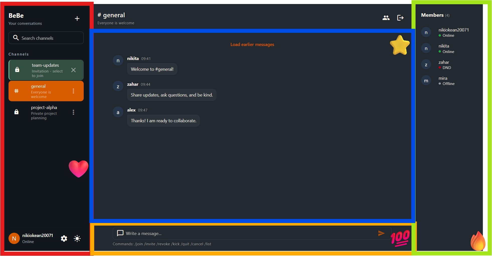
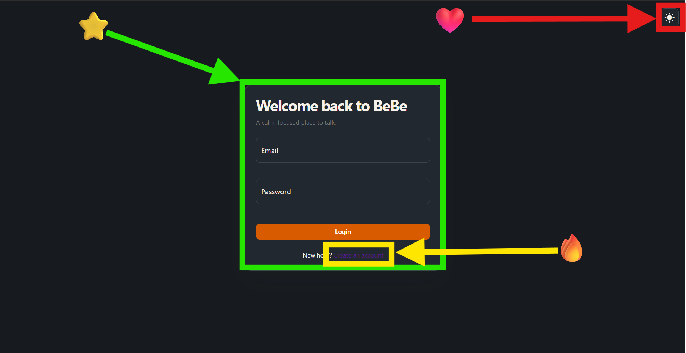
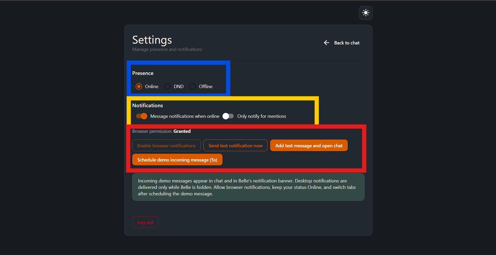

<div align="center">

# 💬 BeBe Chat

**A Discord-like chat web app with public and private channels, slash commands, mentions and notifications.**




</div>

---

## ✨ Features

- 📢 **Channels.** Create, join and leave public or private channels; accept or reject invitations
- ⌨️ **Slash commands.** `/join`, `/invite`, `/revoke`, `/kick`
- 🏷️ **Mentions** and full chat history
- ✍️ **Typing indicators**
- 🟢 **User statuses.** Online, Away, Do Not Disturb
- 🔔 **Notifications**, including a test notification button
- 🎨 **Themes.** Several color themes
- 📱 **Installable PWA** with a service worker

## 🛠 Tech stack

| | |
|---|---|
| Framework | Vue 3 + Quasar 2 (Vite) |
| Language | TypeScript |
| State | Pinia |
| Routing | Vue Router (file-based routes) |
| Quality | oxlint + oxfmt, `node:test` unit tests |

> Built as a project for the VPWA (Progressive Web Applications) course.

## 🚀 How to Run

### Run the full project with Docker

From the repository root, run:

```bash
docker compose up --build
```

Open **http://localhost:9000**. Docker Compose starts the Quasar frontend,
AdonisJS API, and PostgreSQL database; the API applies database migrations
when it starts. Stop the services with `docker compose down`. Database data
is kept in a Docker volume; `docker compose down -v` deletes it.

The API is available at **http://localhost:3333** and PostgreSQL at
**localhost:5433**.

To start the services in the background, add `-d` to the `up` command.
Use `docker compose logs -f` to follow logs.

The database is the same one that `backend/docker-compose.yml` starts for local
development, so both setups share their data and can't run twice at once.

No `APP_KEY` is stored in the repository: without one, the API container
creates a random key each time it starts. To keep a fixed key, put
`APP_KEY=...` in a `.env` file next to `docker-compose.yml` (it is ignored by
git); `node ace generate:key --show` in `backend/` prints a new one.

If Docker reports that the container name `bebe-db` is already in use, it was
created by an older version of this setup. Remove it once with
`docker rm -f bebe-db`; the data in its volume is not deleted.

### 1. Install Dependencies

Navigate to the `quasar-project` directory:

```bash
cd quasar-project
pnpm install
```

Alternatively, you can use `npm`, `yarn` or `bun`.

### 2. Start the App in Development Mode

From the `quasar-project` directory, run:

```bash
pnpm exec quasar dev
```

Alternatively, if Quasar CLI is available globally:

```bash
quasar dev
```

The application will start in development mode with hot module replacement (HMR).

### 3. Format and Lint

To format and lint the files, run:

```bash
pnpm run lint
```

To check formatting and linting without making changes, run:

```bash
pnpm run lint:check
```

### 4. Build for Production

To build the application for production, run:

```bash
pnpm exec quasar build
```

## 📖 How to Use



🔴 Theme switcher — the application supports multiple themes.

🟡 No account? Register by clicking the link.

🟢 Fill in the form to log in to your account.


🔴 Control Panel
Manage your channels in one place. Click the **+** button to create public or private channels. Join or leave channels and accept or reject invitations.

🔵 Chat Window
View your message history and communicate with other channel members.

🟡 Command Line
Use commands to manage channels and members, or type a message to send it directly to the chat.

**Available commands:**
- `/join` — join a channel.
- `/invite` — invite a user to a channel.
- `/revoke` — revoke a user's invitation.
- `/kick` — remove a user from a channel.

🟢 Channel Members
View all members of the current channel and check their online status. Easily see who is available to participate in the conversation.



🔵 Set Your Status
Choose your current status to let other users know your availability:
- **Online** — you are available.
- **Away** — you are temporarily inactive.
- **Do Not Disturb** — you prefer not to be disturbed.

🟡 Enable Notifications
Enable notifications to stay informed about new messages and other chat activity.

🔴 Test Notification
Send a test notification to check whether notifications are working correctly.
